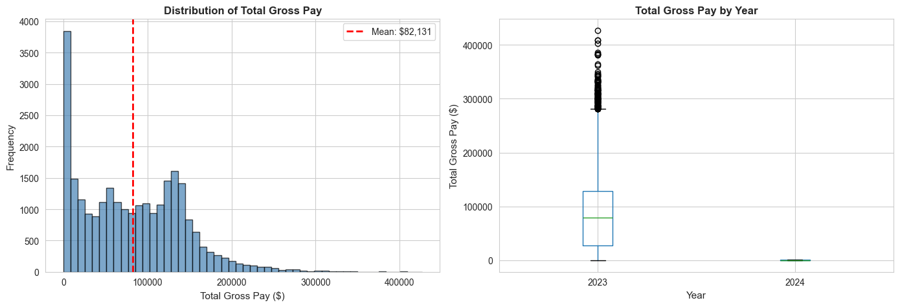
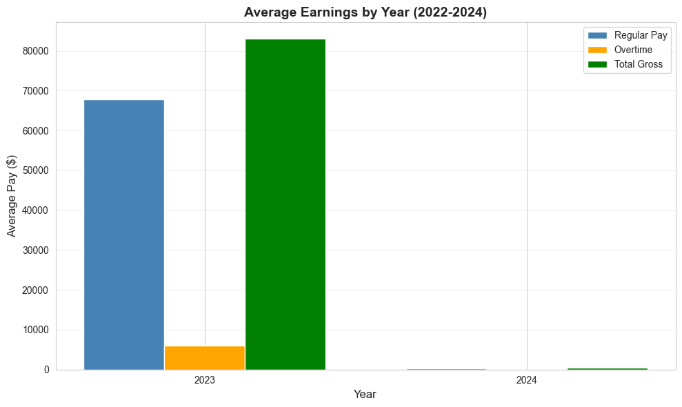
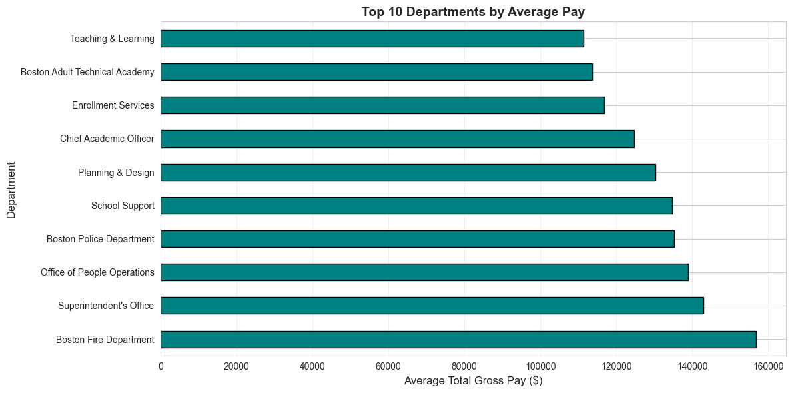
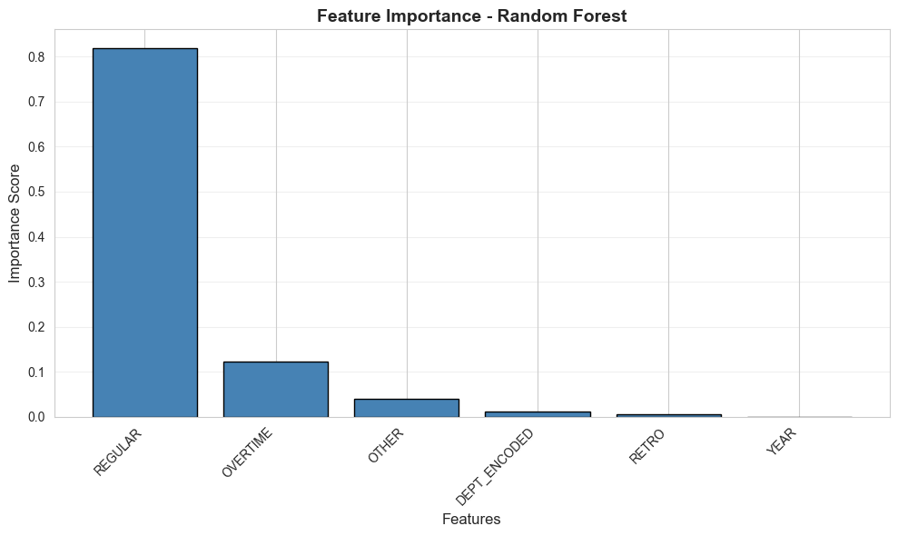

# Boston Employee Earnings Analysis, 2022–2024 — Capstone

Boston publishes what every city employee earns. This capstone turns three years of that open data into a plain-English story: how much Boston workers earn, which departments and jobs pay the most, and what actually explains the differences in pay.

From Northeastern's ALY6140 Python & Analytics course (instructor Daya Rudhramoorthi, CRN 70240, Fall 2025). Authors: Dev Panchal and Om Patel.

## In plain language

Every year, the City of Boston publishes an employee earnings report: each employee's department, job title, regular pay, overtime, and total pay. This project loads the 2022, 2023 and 2024 reports (74,546 employee records in total), cleans them, and asks three questions: how has pay changed year to year, which departments and titles earn the most, and how much of a person's pay can be explained by their department, title and year alone.

The short answer: average total pay was about $83,202 in 2022, $83,014 in 2023, and $94,772 in 2024. Fire and police departments pay the most on average, and a model using only department, title and year explains about 40% of the variation in pay — the rest comes from things this data does not contain, like seniority, hours worked and individual circumstances.

## The honest version story — read this first

There are two versions of this capstone in the folder, and they disagree. This README leads with the correct one and explains the other, instead of blending their numbers.

**Version A — Code 2.0 and the submitted report (19 October 2025). This is the correct three-year analysis.** Its code strips commas and dollar signs from the numbers before converting them, so all three years parse. It covers all 74,546 records. All the headline numbers in this README come from this version.

**Version B — the final notebook and a later report draft (23 October 2025). Its cleaning step is broken.** The final code does not strip commas from numbers like "1,112,348.25", so those values become missing and get dropped, and it mishandles the 2022 column named `TOTAL_ GROSS`. Re-running its cleaning step on the same data leaves only 26,091 records: all of 2023, 279 rows of 2024, and zero rows of 2022. Its headline figures (mean pay $82,130.84, R² 0.9415 and 0.9653) therefore describe mostly 2023, not three years. Its forecast is not quoted anywhere in this README.

Both versions are in this repo, in chronological order, so a reader can see exactly what happened.

## What the data shows (Version A, the correct analysis)

- **Records:** 74,546 employee records — 23,204 in 2022, 25,812 in 2023, 25,530 in 2024. Source: City of Boston employee earnings data, data.boston.gov.
- **Average total pay (TOTAL_GROSS):** 2022 **$83,202.26**, 2023 **$83,013.64**, 2024 **$94,772.20**. Total payroll: $1.93 billion (2022), $2.14 billion (2023), $2.42 billion (2024).
- **Top departments by average pay:** Boston Fire Department and Boston Police Department lead, followed by teachers and other school roles. The linear regression puts the Fire Department premium at **+$99,473** over the baseline, Boston Police at **+$59,071**, and Police Detective at **+$58,653**. Teacher adds +$35,685. At the other end, BPS Substitute Teachers sit at −$58,990 and Lunch Hour Monitors at −$53,986 — these are part-time and hourly roles, so the gap reflects hours worked as much as pay rates.
- **Overtime matters:** overtime pay correlates with total pay at r = 0.5808. An overtime-percentage feature (overtime ÷ regular pay × 100) was created for the analysis.

## What explains pay? (Version A models)

The models use only department, job title and year as inputs — pay components like regular pay and overtime are deliberately **not** used as inputs, because they are parts of the total being predicted.

| Model | Test R² | Test RMSE | Test MAE |
|---|---|---|---|
| Linear Regression | 0.3971 | $50,968.39 | $36,936.79 |
| Random Forest (100 trees, max depth 15) | 0.4027 | $50,729.26 | $36,510.90 |

Department, title and year explain about 40% of the variation in pay. That is the honest figure. The remaining 60% is seniority, hours, overtime, and other factors not in this dataset.

Random Forest feature importance: Boston Fire Department 0.3369, Boston Police Department 0.2972, Teacher 0.1471.

## Why the final notebook's 0.94 R² is not real

The final notebook reports Linear Regression R² 0.9415 and Random Forest R² 0.9653. Those numbers look far better, but they are near-tautological: the models use REGULAR, OVERTIME, RETRO and OTHER pay as inputs, and those four components add up to the total pay being predicted. Predicting a sum from its own parts is not a discovery. The 0.40 figure above is the honest one for "what department, title and year explain".

The final notebook's ARIMA forecast is also not quoted here: it is built on only three yearly points, and one of them (2024) is the broken 279-row sum of $127,594, which produces a 2025 forecast of $127,594 with a confidence interval spanning roughly ±$2.97 billion. That is not a credible forecast.

## What is in this repo

- `capstone-earlier-version-code-2.0/` — the correct three-year pipeline (19 Oct 2025): `capstone_group_dev_om.py` and `capstone_group_dev_om_analysis.ipynb`.
- `capstone-final/` — the later final notebook and code (Week 6): `capstone_group01.ipynb` (42 cells) and `capstone_group01.py`. Read with the version warning above.
- `reports/` — three report files: `Capstone Project Report.pdf` (the submitted report, 19 Oct 2025, Code 2.0 numbers) and its editable source `Capstone Project Report.docx`, plus the later draft `capstone_report_group01.docx` (23 Oct 2025, final-notebook numbers). The later draft even contradicts itself on the yearly averages, so the two reports must not be blended.
- `data/` — the three datasets exactly as the code reads them: `employee_earnings_2022.csv` (23,204 rows), `employee_earnings_2023.csv` (25,812 rows), `employee_earnings_2024.csv` (25,530 rows). These are local downloaded copies of the City of Boston files; the code loads the same files from data.boston.gov URLs.
- `presentation/` — the slide-deck folder (`code.html` plus charts and the Code 2.0 output tables: `yearly_summary.csv`, `model_comparison.csv`, `feature_importance.csv`, `lr_coefficients.csv`). Note: `linear_regression_coefficients.csv` in this folder is a different, later file — its coefficients are ≈1.0 on the pay components (a tautological component fit), not the department/title premiums in `lr_coefficients.csv`. Do not mix them up.
- `images/` — 9 charts extracted from the final notebook. Charts with the same names in `presentation/` are from the Code 2.0 run and show different numbers; the two sets are kept separate.
- `video/` — `video1052003395.mp4` (about 12 min 55 s), the capstone presentation recording from Week 6.

## How to use it

1. Open `reports/Capstone Project Report.pdf` for the submitted write-up.
2. Run `capstone-earlier-version-code-2.0/capstone_group_dev_om.py` with the three CSVs in `data/` to reproduce the correct three-year analysis.
3. Open `capstone-final/capstone_group01.ipynb` to see the later version — and the cleaning bug described above.

## Tools

Python, pandas, scikit-learn (Linear Regression, Random Forest), statsmodels (ARIMA), matplotlib/seaborn, City of Boston open data (data.boston.gov).

## What was left out, and why

- The earliest working version (`Code/` v1) and the `code 3.0` working copies — superseded by Code 2.0 and the final notebook; not double-uploaded.
- The Weeks 1–4 module assignments (Module 1–4 exercises) — they are separate course exercises, not part of this capstone, and are not in the project table for this repo.
- An Apple Numbers file (`linear_regression_coefficients.numbers`) from the presentation folder — a proprietary spreadsheet format, not a project deliverable.
- `__pycache__` folders — Python bytecode, not source.

## Conclusion

Boston's payroll grew from $1.93 billion in 2022 to $2.42 billion in 2024, with average pay jumping in 2024 after two flat years. Fire and police roles sit at the top of the pay scale, and department and title explain about 40% of what any individual earns. The more useful lesson of this project is the one in the version story: a model that looks almost perfect (R² 0.94) can be an artefact of a broken cleaning step and of predicting a total from its own parts. The 0.40 figure, with the cleaning done right, is the one that means something.
